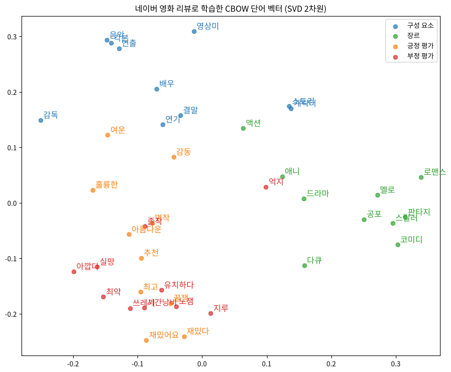

# word2vec 한글 실습: 네이버 영화 리뷰

한글 말뭉치인 네이버 영화 리뷰(NSMC)로 CBOW를 학습하고 평가했다.

- 노트북: [ch04/word2vec_movie.ipynb](ch04/word2vec_movie.ipynb) ([Colab](https://colab.research.google.com/github/paragon0730/DeepLearning_Project2/blob/main/ch04/word2vec_movie.ipynb))
- 데이터: [NSMC](https://github.com/e9t/nsmc) 리뷰 20만 건 중 train 15만 건으로 학습 (약 195만 토큰, 어휘 1만 개)
- 모델: 교재 CBOW + 네거티브 샘플링 (window 5, hidden 100, batch 500, Adam lr 0.005, 4 epoch)

## 결과

**most_similar**

| 질의 | 가까운 단어 |
|---|---|
| 스토리 | 시나리오, 줄거리, 내용전개 |
| 명작 | 걸작, 대작, 수작 |
| 성룡 | 이연걸, 무술, 박중훈 |
| 노잼 | 씹노잼, 재미없음, 개노잼 |
| 최고 | 최악, 최강, 내인생최고 |

**analogy** (단어 행렬 정규화 후)

| 문제 | 결과 |
|---|---|
| 공포영화 : 무서운 = 코미디 : ? | 웃긴 (1위) |
| 한국 : 한국영화 = 일본 : ? | 일본영화 (1위) |
| 남자 : 여자 = 남주 : ? | 여주 (1위) |
| 남자 : 여자 = 아빠 : ? | 엄마 (2위) |
| 배우 : 연기 = 감독 : ? | 연출 (실패) |

**감성 분류** (단어 벡터 평균 + 로지스틱 회귀, test 5만 건)

| 단어 벡터 | 정확도 |
|---|---|
| 무작위 | 62.7% |
| word2vec | 78.5% |



## 실행

```bash
git clone https://github.com/paragon0730/DeepLearning_Project2.git
cd DeepLearning_Project2/ch04
jupyter notebook word2vec_movie.ipynb
```

numpy, matplotlib만 있으면 된다. 학습한 벡터(`ch04/cbow_params_movie.pkl`)가 들어 있어서 학습 없이 평가만 할 수 있다.

## 출처

- 교재 코드: [ssuai/deep_learning_from_scratch2](https://github.com/ssuai/deep_learning_from_scratch2) (MIT)
- 데이터: [e9t/nsmc](https://github.com/e9t/nsmc) (CC0)
